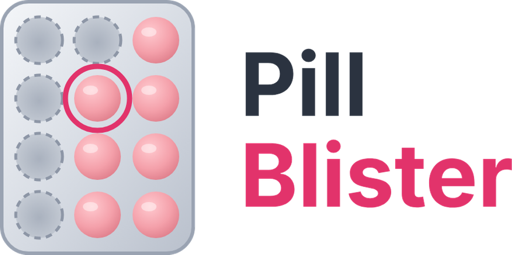

<p align="center"></p>

# Pill Blister

Antibabypille in Home Assistant: Blister mit Zyklus, Einnahmefenster, Einnahme-Tagebuch und Hinweise, wenn laut Beipackzettel zusätzlich verhütet werden muss. Eine Dashboard-Karte, die den Blister 1:1 abbildet, ist dabei.

> **Wichtig:** Die Integration kennt keine medizinischen Regeln. Alle Werte (Einnahmefenster, ab wann eine Pille als vergessen gilt, was dann pro Blisterwoche gilt, Erbrechen/Durchfall) werden beim Einrichten aus dem eigenen Beipackzettel übernommen. Sie zeigt nur Hinweise auf Basis dieser Angaben und behauptet nie, dass Schutz besteht. Im Zweifel: Ärztin oder Apotheke.

## Was es macht

- **Zyklus:** z. B. 21 Einnahmetage, 7 Tage Pause, ab dem Starttag des aktuellen Blisters. Der Start lässt sich jederzeit über `date.<name>_pill_blister_start` ändern, die Einnahmezeit über `time.<name>_pill_dose_time`.
- **Einnahmefenster:** Eine Einnahme zählt für den Tag, in dessen Fenster (z. B. 2 h vorher bis 12 h nachher) sie liegt, auch nach Mitternacht. Ist das nicht eindeutig (außerhalb jedes Fensters oder der Tag ist schon eingetragen), wird **gefragt statt geraten**: `sensor.<name>_pill_pending_intake` und das Event `pill_blister_needs_assignment`, beantwortet mit `pill_blister.assign_intake`.
- **Tagebuch:** Pro Tag Uhrzeit (oder „unbekannt“), Quelle und ob nachgetragen. Pünktlichkeit wird daraus berechnet. Gespeichert in `.storage`, 400 Tage.
- **Vergessene Pille:** Kein Eintrag bis „Vergessen ab“ (z. B. 12 h nach der Einnahmezeit) oder eine noch spätere Einnahme → Hinweis „zusätzlich verhüten bis …“ mit dem Text der passenden Blisterwoche. Optional eigene Regel für mehrere vergessene Pillen im selben Blister.
- **Erbrechen, Durchfall & Co.:** Frei einrichtbare Ereignisse. Liegt eines innerhalb der eingestellten Stunden nach einer Einnahme, gibt es zuerst den Hinweis „Ersatzpille bis … möglich“; ohne Ersatzpille gilt die Regel für eine vergessene Pille oder eine eigene.
- **Zeitraum eines Hinweises:** ab der nachgeholten Einnahme bzw. ab der vergessenen Einnahmezeit bzw. ab dem Ereignis, für die eingestellte Anzahl Tage.

## Entitäten

| Entität | Bedeutung |
|---|---|
| `sensor.<name>_pill_status` | `later` / `due` / `overdue` (gestern noch offen, Fenster läuft) / `done` / `pause` / `last_pause_day`; Attribute für die Karte (Tage, Hinweise, offene Einnahme, …) |
| `sensor.<name>_pill_pill_number` | Pille 1–21, in der Pause leer |
| `sensor.<name>_pill_missing_entries` | Tage im aktuellen Blister ohne Eintrag |
| `sensor.<name>_pill_last_taken` | Letzte Einnahme |
| `sensor.<name>_pill_notice_until` | Ende des längsten aktiven Hinweises |
| `sensor.<name>_pill_pending_intake` | Einnahme, die noch einem Tag zugeordnet werden muss |
| `binary_sensor.<name>_pill_due` | Ab Einnahmezeit bis zum Eintrag (auch nach Mitternacht im Fenster) |
| `binary_sensor.<name>_pill_notice` | Hinweis aktiv (Problem) |
| `button.<name>_pill_taken` | Jetzt genommen |
| `date.<name>_pill_blister_start`, `time.<name>_pill_dose_time` | Blisterstart und Einnahmezeit |
| `calendar.<name>_pill_calendar` | Tagebuch, geplante Einnahmen, Pausen und Hinweise |

## Dienste

`mark_taken` (optional `date`, `time`, `time_unknown`, `source`; liefert `{pending, day}` zurück), `remove_entry`, `assign_intake` (`date` oder `discard`), `start_blister`, `report_event` (`type`, `datetime`), `remove_event`, `mark_replacement`. Alle brauchen `config_entry_id`.

## Events

`pill_blister_due`, `pill_blister_taken` (mit `punctuality`, `deviation_min`, `in_window`, `source`), `pill_blister_missed`, `pill_blister_needs_assignment` (mit `choices` für Push-Buttons), `pill_blister_notice_started` / `_ended`, `pill_blister_entry_changed`. Erinnerungen (Push, Sprachansagen …) baut man damit als eigene Automation.

## Karte

Wird mitgeliefert und automatisch als Ressource eingetragen (`/pill_blister/pill-blister-card.js`, bei YAML-Dashboards von Hand).

```yaml
type: custom:pill-blister-card
entity: sensor.<name>_pill_status
settings_hash: "#pille-einstellungen"  # optional: Zahnrad öffnet ein Popup
```

Antippen einer Pille öffnet den Tag: Uhrzeit und Pünktlichkeit, Uhrzeit ändern, nachtragen, entfernen, Erbrechen/Durchfall melden. Das Blister-Layout lässt sich mit `columns` anpassen.

## Entwicklung

```bash
python3 scripts/run_pure_tests.py   # Engine-Tests ohne Home Assistant
pip install -r requirements_test.txt && pytest -q
```
